<picture>
  <source media="(prefers-color-scheme: dark)" srcset="./assets/dark/hero.svg" />
  <source media="(prefers-color-scheme: light)" srcset="./assets/light/hero.svg" />
  
</picture>

  <a href="https://gunerkaan.com"><b>gunerkaan.com</b></a>
  &nbsp;·&nbsp;
  <a href="https://www.linkedin.com/in/kaang%C3%BCner">LinkedIn</a>
  &nbsp;·&nbsp;
  <a href="mailto:guner.kaan@outlook.com">Email</a>
  &nbsp;·&nbsp;
  <a href="#selected-work">Selected work ↓</a>

 

<picture>
  <source media="(prefers-color-scheme: dark)" srcset="./assets/dark/section-about.svg" />
  <source media="(prefers-color-scheme: light)" srcset="./assets/light/section-about.svg" />
  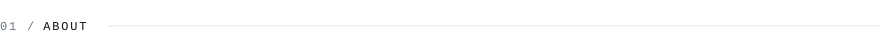
</picture>

I'm a Computer Engineering student at Antalya Bilim University, graduating in January 2027. I build software and machine learning systems and take them into real use.

At Enelsa I built an anomaly detection system that went live on an industrial water treatment line. Now I'm building **SQLBuddy**, a text-to-SQL product with a multi-LLM router, and I work as a student researcher on a TÜBİTAK 1002 project on privacy-preserving ML for EEG data. I test models on independent data and document their limits as clearly as their results.

<picture>
  <source media="(prefers-color-scheme: dark)" srcset="./assets/dark/glance.svg" />
  <source media="(prefers-color-scheme: light)" srcset="./assets/light/glance.svg" />
  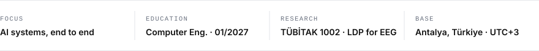
</picture>

  

<picture>
  <source media="(prefers-color-scheme: dark)" srcset="./assets/dark/section-experience.svg" />
  <source media="(prefers-color-scheme: light)" srcset="./assets/light/section-experience.svg" />
  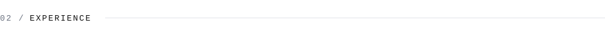
</picture>

<picture>
  <source media="(prefers-color-scheme: dark)" srcset="./assets/dark/experience.svg" />
  <source media="(prefers-color-scheme: light)" srcset="./assets/light/experience.svg" />
  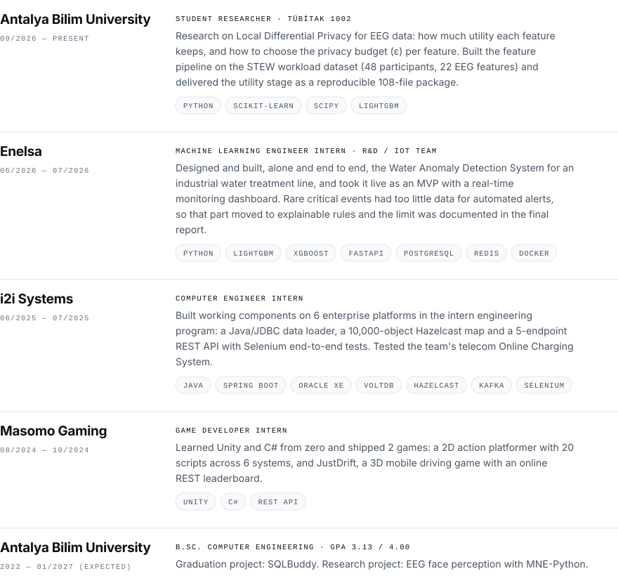
</picture>

  

<picture>
  <source media="(prefers-color-scheme: dark)" srcset="./assets/dark/section-work.svg" />
  <source media="(prefers-color-scheme: light)" srcset="./assets/light/section-work.svg" />
  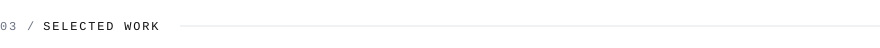
</picture>

<a href="https://gunerkaan.com/projects#sqlbuddy">
<picture>
  <source media="(prefers-color-scheme: dark)" srcset="./assets/dark/project-sqlbuddy.svg" />
  <source media="(prefers-color-scheme: light)" srcset="./assets/light/project-sqlbuddy.svg" />
  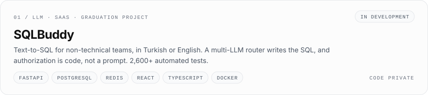
</picture>
</a>

<a href="https://gunerkaan.com/projects#water">
<picture>
  <source media="(prefers-color-scheme: dark)" srcset="./assets/dark/project-water.svg" />
  <source media="(prefers-color-scheme: light)" srcset="./assets/light/project-water.svg" />
  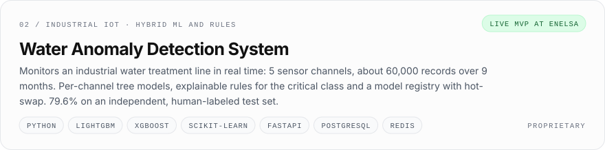
</picture>
</a>

<a href="https://github.com/kaanguner4/claude-island">
<picture>
  <source media="(prefers-color-scheme: dark)" srcset="./assets/dark/project-claude-island.svg" />
  <source media="(prefers-color-scheme: light)" srcset="./assets/light/project-claude-island.svg" />
  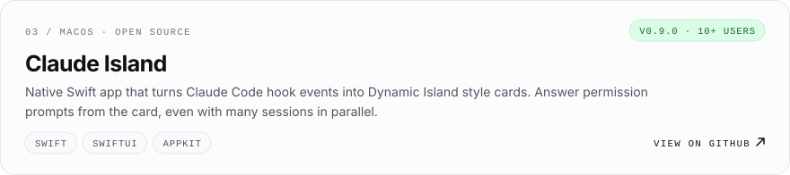
</picture>
</a>

<picture>
  <source media="(prefers-color-scheme: dark)" srcset="./assets/dark/project-ruvin.svg" />
  <source media="(prefers-color-scheme: light)" srcset="./assets/light/project-ruvin.svg" />
  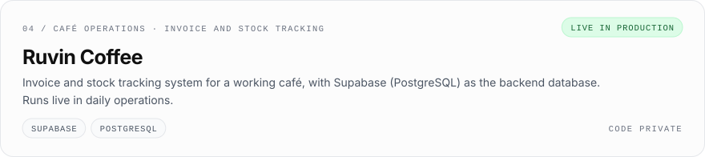
</picture>

<a href="https://github.com/kaanguner4/TrackLearnerAI">
<picture>
  <source media="(prefers-color-scheme: dark)" srcset="./assets/dark/project-tracklearner.svg" />
  <source media="(prefers-color-scheme: light)" srcset="./assets/light/project-tracklearner.svg" />
  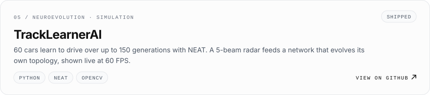
</picture>
</a>

<a href="https://github.com/kaanguner4/NAC-System">
<picture>
  <source media="(prefers-color-scheme: dark)" srcset="./assets/dark/project-nac.svg" />
  <source media="(prefers-color-scheme: light)" srcset="./assets/light/project-nac.svg" />
  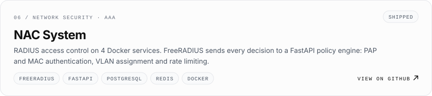
</picture>
</a>

<a href="https://github.com/kaanguner4/CarTagWebGame">
<picture>
  <source media="(prefers-color-scheme: dark)" srcset="./assets/dark/project-car-tag.svg" />
  <source media="(prefers-color-scheme: light)" srcset="./assets/light/project-car-tag.svg" />
  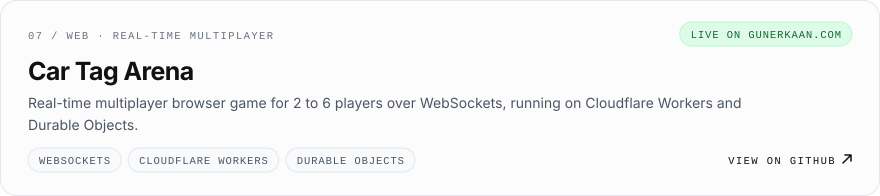
</picture>
</a>

<a href="https://gunerkaan.com/projects"><b>See all projects ↗</b></a>

 

<picture>
  <source media="(prefers-color-scheme: dark)" srcset="./assets/dark/section-toolkit.svg" />
  <source media="(prefers-color-scheme: light)" srcset="./assets/light/section-toolkit.svg" />
  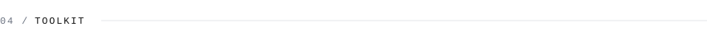
</picture>

<picture>
  <source media="(prefers-color-scheme: dark)" srcset="./assets/dark/toolkit.svg" />
  <source media="(prefers-color-scheme: light)" srcset="./assets/light/toolkit.svg" />
  
</picture>

  

<picture>
  <source media="(prefers-color-scheme: dark)" srcset="./assets/dark/section-activity.svg" />
  <source media="(prefers-color-scheme: light)" srcset="./assets/light/section-activity.svg" />
  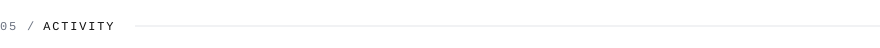
</picture>

<picture>
  <source media="(prefers-color-scheme: dark)" srcset="https://raw.githubusercontent.com/kaanguner4/kaanguner4/output/github-contribution-grid-snake-dark.svg" />
  <source media="(prefers-color-scheme: light)" srcset="https://raw.githubusercontent.com/kaanguner4/kaanguner4/output/github-contribution-grid-snake.svg" />
  
</picture>

  

<picture>
  <source media="(prefers-color-scheme: dark)" srcset="./assets/dark/contact.svg" />
  <source media="(prefers-color-scheme: light)" srcset="./assets/light/contact.svg" />
  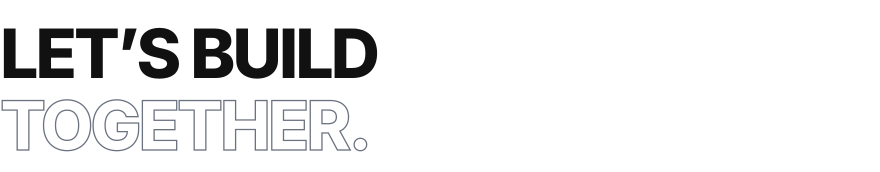
</picture>

Internships, projects, or a good engineering conversation.

<a href="mailto:guner.kaan@outlook.com"><b>guner.kaan@outlook.com</b></a>
&nbsp;·&nbsp;
<a href="https://www.linkedin.com/in/kaang%C3%BCner">LinkedIn</a>
&nbsp;·&nbsp;
<a href="https://gunerkaan.com">Website</a>

 

© 2026 KAAN GÜNER · <a href="https://gunerkaan.com">GUNERKAAN.COM</a>
